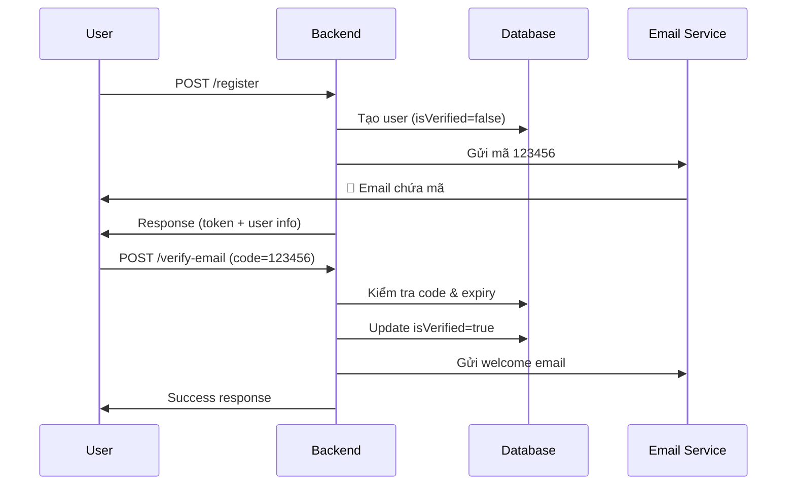

# 📧 Email Verification API

## Tính năng mới

Khi user đăng ký, hệ thống sẽ:
1. ✅ Tạo tài khoản với mã xác thực 6 số
2. 📧 Gửi email chứa mã xác thực (hiệu lực 15 phút)
3. ⏳ User cần verify email để sử dụng đầy đủ tính năng

---

## API Endpoints

### 1. Đăng ký (đã cập nhật)

```bash
POST http://localhost:3000/api/auth/register
Content-Type: application/json

{
  "email": "user@example.com",
  "password": "password123",
  "displayName": "John Doe"
}
```

**Response:**
```json
{
  "success": true,
  "message": "Registration successful",
  "data": {
    "accessToken": "eyJhbGciOiJIUzI1NiIs...",
    "refreshToken": "eyJhbGciOiJIUzI1NiIs...",
    "user": {
      "id": "clx123",
      "email": "user@example.com",
      "isVerified": false
    }
  }
}
```

> 📧 Email chứa mã xác thực 6 số sẽ được gửi đến `user@example.com`

---

### 2. Xác thực email

```bash
POST http://localhost:3000/api/auth/verify-email
Content-Type: application/json

{
  "email": "user@example.com",
  "code": "123456"
}
```

**Response (thành công):**
```json
{
  "success": true,
  "message": "Email verified successfully",
  "data": {
    "message": "Email verified successfully"
  }
}
```

**Response (mã sai):**
```json
{
  "success": false,
  "message": "Invalid verification code",
  "timestamp": "2026-01-10T10:00:00.000Z"
}
```

**Response (mã hết hạn):**
```json
{
  "success": false,
  "message": "Verification code expired",
  "timestamp": "2026-01-10T10:00:00.000Z"
}
```

---

### 3. Gửi lại mã xác thực

```bash
POST http://localhost:3000/api/auth/resend-verification
Content-Type: application/json

{
  "email": "user@example.com"
}
```

**Response:**
```json
{
  "success": true,
  "message": "Verification code sent successfully",
  "data": {
    "message": "Verification code sent successfully"
  }
}
```

---

## Cấu hình SMTP

### 1. Thêm vào file `.env`:

```env
# Email (SMTP) - Gmail example
SMTP_HOST="smtp.gmail.com"
SMTP_PORT=587
SMTP_SECURE=false
SMTP_USER="your-email@gmail.com"
SMTP_PASS="your-app-password"
SMTP_FROM_EMAIL="noreply@lostfound.com"
SMTP_FROM_NAME="Lost & Found"
```

### 2. Cách lấy App Password từ Gmail:

1. Vào [Google Account Settings](https://myaccount.google.com/)
2. Chọn **Security** → **2-Step Verification** (bật nếu chưa có)
3. Tìm **App passwords**
4. Tạo password mới cho "Mail"
5. Copy password và paste vào `SMTP_PASS`

### 3. SMTP providers khác:

#### **SendGrid**
```env
SMTP_HOST="smtp.sendgrid.net"
SMTP_PORT=587
SMTP_USER="apikey"
SMTP_PASS="your-sendgrid-api-key"
```

#### **Mailgun**
```env
SMTP_HOST="smtp.mailgun.org"
SMTP_PORT=587
SMTP_USER="postmaster@your-domain.mailgun.org"
SMTP_PASS="your-mailgun-password"
```

#### **Amazon SES**
```env
SMTP_HOST="email-smtp.us-east-1.amazonaws.com"
SMTP_PORT=587
SMTP_USER="your-ses-smtp-username"
SMTP_PASS="your-ses-smtp-password"
```

---

## Database Migration

Chạy migration để thêm các trường mới:

```bash
npm run prisma:migrate
npm run prisma:generate
```

**Các trường mới trong User model:**
- `isVerified` (Boolean) - Trạng thái xác thực email
- `verificationCode` (String?) - Mã xác thực 6 số
- `verificationCodeExpiry` (DateTime?) - Thời gian hết hạn mã

---

## Luồng hoạt động



---

## Test với cURL

### Đăng ký
```bash
curl -X POST http://localhost:3000/api/auth/register \
  -H "Content-Type: application/json" \
  -d '{
    "email": "test@example.com",
    "password": "password123",
    "displayName": "Test User"
  }'
```

### Xác thực email
```bash
curl -X POST http://localhost:3000/api/auth/verify-email \
  -H "Content-Type: application/json" \
  -d '{
    "email": "test@example.com",
    "code": "123456"
  }'
```

### Gửi lại mã
```bash
curl -X POST http://localhost:3000/api/auth/resend-verification \
  -H "Content-Type: application/json" \
  -d '{
    "email": "test@example.com"
  }'
```

---

## Development Mode

Nếu không cấu hình SMTP, email sẽ được log vào console:

```
[INFO] Email would be sent: {
  to: 'user@example.com',
  subject: 'Xác thực tài khoản',
  preview: 'Mã xác thực của bạn là: 123456'
}
```

---

## Security Notes

- ✅ Mã xác thực có hiệu lực 15 phút
- ✅ Mã là số ngẫu nhiên 6 chữ số
- ✅ User có thể request mã mới bất cứ lúc nào
- ✅ Mã sẽ bị xóa sau khi verify thành công
- 🔒 Nên thêm rate limiting cho `/resend-verification`
- 🔒 Có thể thêm max attempts cho verify

---

## Next Steps

1. ✅ Install dependencies: `npm install`
2. ✅ Cấu hình SMTP trong `.env`
3. ✅ Run migration: `npm run prisma:migrate`
4. ✅ Start server: `npm run dev`
5. ✅ Test registration flow

🎉 Done!
