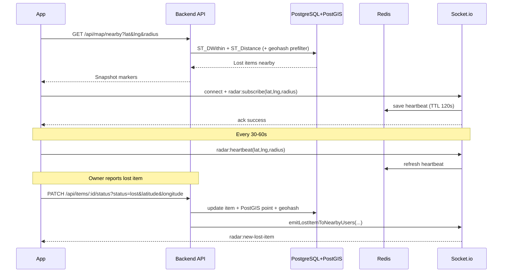

# Live Radar API & Realtime Flow (FindBack)

Tài liệu này mô tả đầy đủ luồng Live Radar theo đúng implementation backend hiện tại để bên App (Mobile/Web) tích hợp nhanh, đúng contract, và tránh sai payload.

## 1. Mục tiêu tính năng

Live Radar cho phép:

1. Tải danh sách đồ thất lạc quanh vị trí user theo bán kính.
2. Nhận sự kiện realtime khi có đồ mới được báo mất gần vùng radar đang theo dõi.
3. Giảm tải DB bằng geohash pre-filter + spatial index PostGIS.

## 2. Kiến trúc tổng quan

Backend hiện tại gồm 3 lớp chính:

1. **REST API** để load dữ liệu bản đồ (`GET /api/map/nearby`).
2. **Socket.io** để subscribe vùng radar và nhận push realtime.
3. **PostgreSQL + PostGIS + Redis** để truy vấn nhanh và xử lý heartbeat.

Luồng xử lý:

1. App gọi `GET /api/map/nearby` để load snapshot ban đầu.
2. App mở Socket và subscribe vùng radar (`radar:subscribe`).
3. Khi chủ đồ báo mất (`PATCH /api/items/:id/status?status=lost...`), backend ghi tọa độ vào PostGIS và phát event `radar:new-lost-item` cho user gần đó.
4. App update marker ngay mà không cần pull lại toàn bộ map.

## 3. Database Contract (PostGIS)

Migration đã thêm vào bảng `Item` các cột phục vụ radar:

- `latitude` (DOUBLE PRECISION)
- `longitude` (DOUBLE PRECISION)
- `location_geohash` (VARCHAR(16))
- `location` (geography(Point,4326))
- `location_updated_at` (TIMESTAMP)

Index hiệu năng:

- `Item_location_gist_idx` (GIST trên `location`) cho `ST_DWithin` / `ST_Distance`.
- `Item_location_geohash_idx` (B-Tree trên `location_geohash`) cho pre-filter geohash.

## 4. Chuẩn auth dùng cho App

### 4.1 REST API

Bắt buộc header:

```http
Authorization: Bearer <access_token>
```

### 4.2 Socket.io

Socket middleware chấp nhận token theo 1 trong 2 cách:

1. `auth.token` trong handshake (khuyến nghị)
2. Header `Authorization: Bearer <token>`

Ví dụ client:

```ts
import { io } from "socket.io-client";

const socket = io("https://your-api-domain", {
  auth: {
    token: `Bearer ${accessToken}`,
  },
});
```

## 5. REST API cho Radar

## 5.1 GET /api/map/nearby

### Mục đích

Lấy danh sách đồ **status = lost** nằm trong bán kính radar tính từ vị trí user.

### Endpoint

```http
GET /api/map/nearby?lat=<lat>&lng=<lng>&radius=<meters>&limit=<n>
```

### Query params

| Param | Bắt buộc | Kiểu | Range | Default |
| --- | --- | --- | --- | --- |
| `lat` | Có | number (string) | `[-90, 90]` | - |
| `lng` | Có | number (string) | `[-180, 180]` | - |
| `radius` | Không | number (string) | `[100, 20000]` | `3000` |
| `limit` | Không | integer (string) | `[1, 200]` | `50` |

Lưu ý:

1. Backend validate từ `req.query`, nên app truyền query string là an toàn nhất.
2. Truy vấn DB dùng PostGIS `ST_DWithin` + geohash pre-filter.

### Response success

```json
{
  "success": true,
  "message": "Nearby lost items loaded successfully",
  "data": {
    "items": [
      {
        "id": "cmnzpt2hp0001ubr05gfyrbjp",
        "itemId": "demo-1776237266651-1-afad",
        "name": "MacBook Pro 14 inch",
        "category": "electronics",
        "description": "Laptop silver with FindBack sticker",
        "lostMessage": "Lost near Notre-Dame Cathedral around 19:00",
        "imagePublicUrl": "https://...",
        "latitude": 10.779783,
        "longitude": 106.699018,
        "distanceMeters": 230,
        "reportedAt": "2026-04-15T07:14:26.653Z"
      }
    ],
    "total": 1
  },
  "timestamp": "2026-04-15T08:00:00.000Z"
}
```

### Response lỗi thường gặp

```json
{
  "success": false,
  "message": "Validation failed",
  "error": "lat must be a valid number",
  "timestamp": "2026-04-15T08:00:00.000Z"
}
```

```json
{
  "success": false,
  "message": "No token provided",
  "timestamp": "2026-04-15T08:00:00.000Z"
}
```

## 5.2 PATCH /api/items/:id/status (API kích hoạt realtime)

### Mục đích

Đây là API chủ đồ dùng để đổi trạng thái món đồ. Khi chuyển sang `lost`, backend sẽ phát realtime event cho người dùng đang ở gần.

### Endpoint

```http
PATCH /api/items/:id/status?status=lost&lostMessage=...&latitude=...&longitude=...
```

Lưu ý quan trọng:

1. Endpoint này hiện đọc dữ liệu từ **query params** (`req.query`) chứ không phải JSON body.
2. `latitude` và `longitude` phải truyền cùng nhau (hoặc bỏ cả 2).
3. Khi `status=lost` mà không có tọa độ mới, backend thử fallback từ `lastSeenLocation` của item.
4. Nếu không có tọa độ nào hợp lệ -> trả lỗi 400.

### Query params

| Param | Bắt buộc | Ghi chú |
| --- | --- | --- |
| `status` | Có | `safe` hoặc `lost` |
| `lostMessage` | Không | tối đa 500 ký tự |
| `latitude` | Có khi báo mất mới | truyền cùng `longitude` |
| `longitude` | Có khi báo mất mới | truyền cùng `latitude` |

### Hành vi backend khi `status=lost`

1. Update trạng thái item sang `lost`.
2. Tính geohash từ tọa độ.
3. Ghi `latitude`, `longitude`, `location_geohash`, `location` (PostGIS point).
4. Emit Socket event `radar:new-lost-item` cho user trong vùng.

### Hành vi backend khi `status=safe`

1. Update trạng thái item sang `safe`.
2. Xóa geospatial fields (`latitude`, `longitude`, `location_geohash`, `location`).
3. Không emit event radar mới.

## 6. Socket.io Contract cho Live Radar

## 6.1 Kết nối

- Server dùng socket.io mặc định path: `/socket.io`
- CORS origin dựa trên `FRONTEND_URL`

## 6.2 Client Events

### a) `radar:subscribe`

App gọi khi vào màn hình radar hoặc đổi vùng theo dõi.

Payload:

```json
{
  "latitude": 10.7769,
  "longitude": 106.7009,
  "radius": 3000
}
```

ACK success:

```json
{
  "success": true,
  "data": {
    "joinedRooms": 36,
    "precision": 5,
    "radiusMeters": 3000
  }
}
```

ACK error:

```json
{
  "success": false,
  "message": "Radius must be between 100 and 20000 meters"
}
```

### b) `radar:heartbeat`

App gọi định kỳ mỗi `30-60s` để cập nhật vị trí realtime.

Payload giống `radar:subscribe`:

```json
{
  "latitude": 10.77695,
  "longitude": 106.70103,
  "radius": 3000
}
```

Ghi chú:

1. Backend vừa cập nhật room geohash, vừa gia hạn heartbeat cache trong Redis.
2. TTL hiện tại là `120s`.

### c) `radar:unsubscribe`

Gọi khi rời màn hình map hoặc logout.

ACK:

```json
{
  "success": true
}
```

## 6.3 Server Event

### `radar:new-lost-item`

Backend push event này khi có món đồ mới vừa được báo mất và nằm trong bán kính user.

Payload:

```json
{
  "id": "cmnzpt2hp0001ubr05gfyrbjp",
  "itemId": "demo-1776237266651-1-afad",
  "name": "MacBook Pro 14 inch",
  "category": "electronics",
  "description": "Laptop silver with FindBack sticker",
  "lostMessage": "Lost near Notre-Dame Cathedral around 19:00",
  "imagePublicUrl": "https://...",
  "latitude": 10.779783,
  "longitude": 106.699018,
  "reportedAt": "2026-04-15T07:14:26.653Z",
  "distanceMeters": 230
}
```

## 7. Realtime targeting backend làm như thế nào

1. User subscribe -> backend phân vùng thành nhiều room geohash theo bán kính.
2. Khi có lost item mới -> backend lookup room ứng viên theo geohash precision `3..7`.
3. Với từng socket ứng viên, backend tính khoảng cách thật bằng haversine.
4. Chỉ socket nào `distanceMeters <= radiusMeters` mới nhận event.

=> Không broadcast toàn hệ thống, giảm noise và tăng hiệu năng.

## 8. Bảo mật và riêng tư

1. API map và update status đều yêu cầu JWT hợp lệ.
2. Socket handshake bắt buộc JWT.
3. API map + socket event chỉ trả dữ liệu công khai của item (không trả email/sđt chủ đồ).
4. Heartbeat user được lưu cache Redis theo TTL, không ghi liên tục vào DB chính.

## 9. Trình tự tích hợp cho App (khuyến nghị)

1. Vào Radar screen:
- Lấy GPS hiện tại.
- Gọi `GET /api/map/nearby` để load marker ban đầu.
- Mở socket và emit `radar:subscribe`.

2. Trong khi user ở màn hình Radar:
- Gửi `radar:heartbeat` mỗi `30-60s`.
- Lắng nghe `radar:new-lost-item` để add marker mới realtime.

3. Khi rời màn hình:
- Emit `radar:unsubscribe`.
- Có thể giữ socket chung app hoặc disconnect tùy kiến trúc app.

## 10. Sequence diagram



## 11. Ví dụ code App (TypeScript)

```ts
import { io, Socket } from "socket.io-client";

type RadarAck = {
  success: boolean;
  message?: string;
  data?: {
    joinedRooms?: number;
    precision?: number;
    radiusMeters?: number;
  };
};

export function createRadarSocket(baseUrl: string, accessToken: string): Socket {
  return io(baseUrl, {
    auth: {
      token: `Bearer ${accessToken}`,
    },
    transports: ["websocket"],
  });
}

export function subscribeRadar(
  socket: Socket,
  latitude: number,
  longitude: number,
  radius = 3000
): Promise<RadarAck> {
  return new Promise((resolve) => {
    socket.emit("radar:subscribe", { latitude, longitude, radius }, (ack: RadarAck) => {
      resolve(ack);
    });
  });
}

export function startRadarHeartbeat(
  socket: Socket,
  getPosition: () => { latitude: number; longitude: number },
  radius = 3000,
  intervalMs = 30000
) {
  const timer = setInterval(() => {
    const pos = getPosition();
    socket.emit("radar:heartbeat", {
      latitude: pos.latitude,
      longitude: pos.longitude,
      radius,
    });
  }, intervalMs);

  return () => clearInterval(timer);
}
```

## 12. Checklist QA nhanh

1. Test `GET /api/map/nearby` với tọa độ hợp lệ -> có danh sách `items` + `distanceMeters`.
2. Test lỗi validation với `radius=99999` -> trả 400.
3. Mở 2 thiết bị ở 2 vị trí xa nhau, báo mất item gần thiết bị A -> chỉ A nhận `radar:new-lost-item`.
4. Chuyển item từ `lost` -> `safe`, gọi lại nearby -> item biến mất khỏi radar.

---

Nếu cần, có thể tách tài liệu này thành 2 file riêng:

1. `LIVE_RADAR_APP_GUIDE.md` (cho team App)
2. `LIVE_RADAR_BACKEND_NOTES.md` (cho team BE/DevOps)
